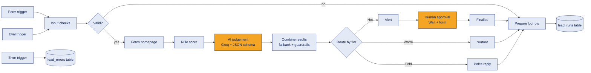
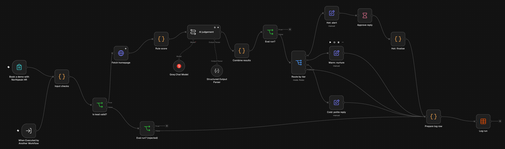
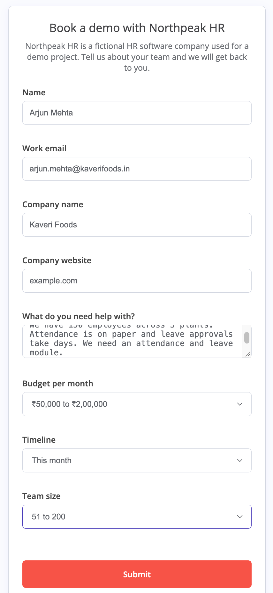
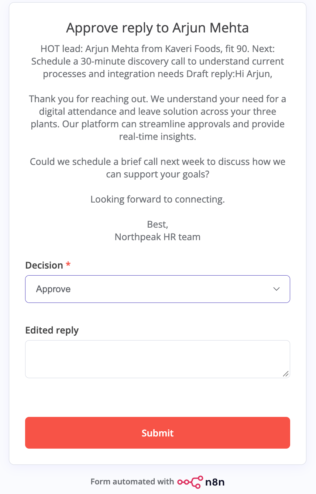
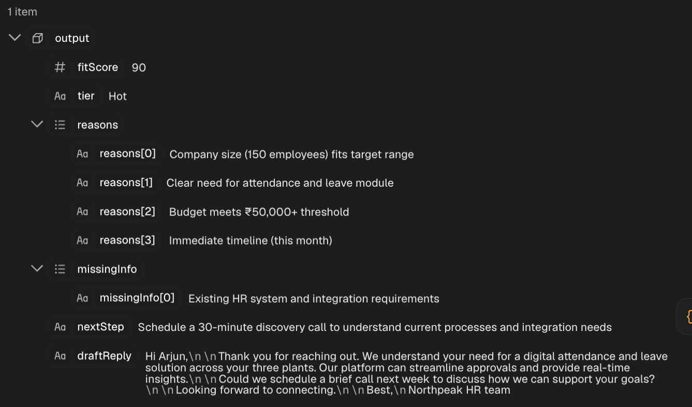
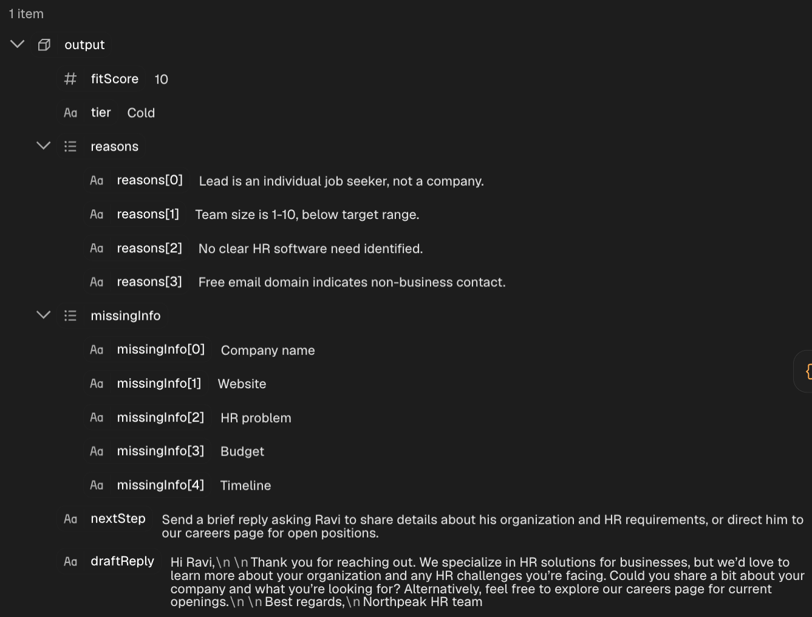
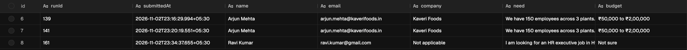
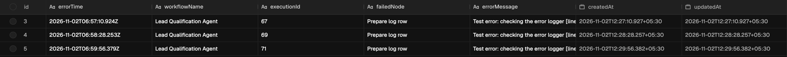
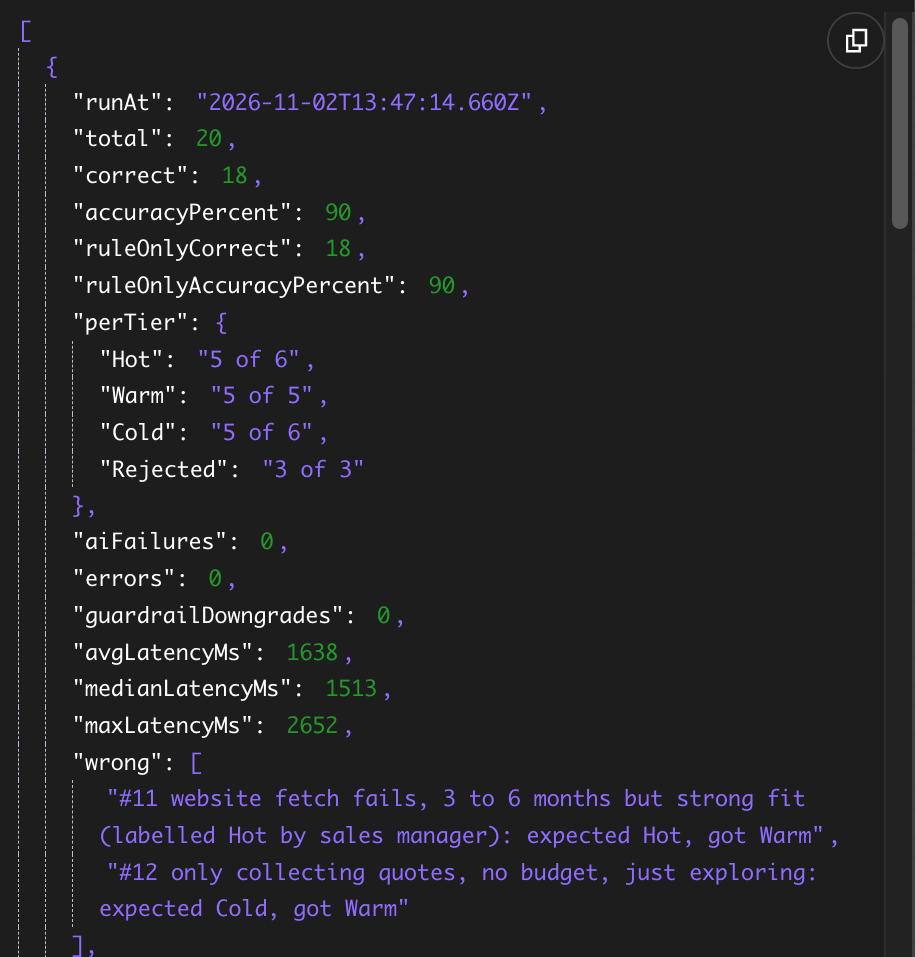
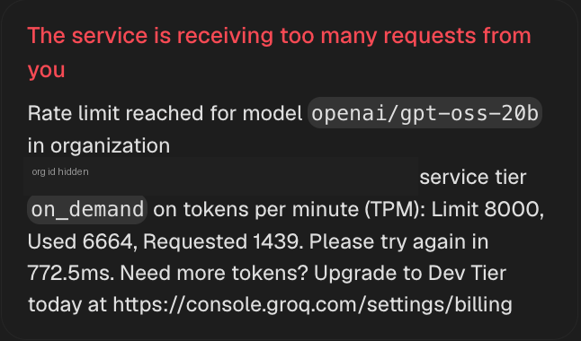

https://github.com/user-attachments/assets/6b5bdbc5-f9e9-4106-a15e-9d2cd8b98334


# AI Lead Qualification Agent (n8n + Groq)

A no-code agent that reads inbound demo requests, scores them with plain rules, asks an LLM for a judgement, routes each lead to Hot, Warm or Cold, keeps a human in the loop for Hot leads, and logs every run.

Built on self-hosted n8n Community Edition with a free Groq API key. No paid tools, no extra accounts.

<!-- DEMO VIDEO: drag the .mp4 into this spot when editing on github.com -->

## Contents

1. [Problem](#problem)
2. [What it does](#what-it-does)
3. [Architecture](#architecture)
4. [Screenshots](#screenshots)
5. [Tech stack](#tech-stack)
6. [Scoring logic](#scoring-logic)
7. [Results](#results)
8. [Cost](#cost)
9. [Limits](#limits)
10. [Setup](#setup)
11. [Repository files](#repository-files)
12. [What I learned](#what-i-learned)

## Problem

Every B2B software company gets "book a demo" forms. Many are not real buyers: job seekers, students, agencies selling their own services, spam. Sales teams lose time reading all of them, and good leads wait too long for a reply.

This project uses a fictional company, **Northpeak HR** (a cloud HR software company for Indian businesses), as the example business. All names, companies and leads in this repository are made up.

## What it does

1. A lead fills a form: name, work email, company, website, need, budget, timeline, team size.
2. **Input checks (code):** required fields, email format, spam words and links, free email domains.
3. **Fetch homepage:** reads the company website as extra context. Times out after 10 seconds and continues if the site is missing or down.
4. **Rule score (code):** turns budget, timeline and team size into a score from 0 to 100.
5. **AI judgement (Groq, `openai/gpt-oss-20b`):** returns fit score, tier, reasons, missing info, next step and a draft reply, forced into a fixed JSON schema.
6. **Combine results (code):** fallback to the rule score if the AI fails, plus guardrails where code has the final say.
7. **Route:**
   * **Hot:** sales alert, then the workflow pauses on an approval form. A person approves, edits or rejects the AI draft.
   * **Warm:** nurture, follow up in 30 days.
   * **Cold:** polite reply.
8. **Log:** every run (including rejected leads) is written to an n8n Data table.
9. **Error workflow:** if the main workflow crashes, a second workflow logs the failed node and error message.

Design rule: **plain code for rules and control, AI only for judgement.**

## Architecture



The two orange boxes are the only places where a model or a person makes a judgement. Everything else is deterministic code.

Evaluation runs enter through a second trigger and stop right after Combine results, so testing never sends replies, waits for approval or writes to the real log.



## Screenshots

| The form | Human approval for a Hot lead |
|---|---|
|  |  |

**AI judgement for a Hot lead:**



**AI judgement for a job seeker (rules alone cannot see this):**



**Every run is logged, and failures go to a separate error log:**





## Tech stack

| Part | Tool |
|---|---|
| Workflow engine | n8n Community Edition 2.45.7, self-hosted on a Mac, Node.js 24 |
| LLM | Groq API, model `openai/gpt-oss-20b`, temperature 0.2 |
| Structured output | n8n Structured Output Parser with a JSON Schema |
| Form, approval, storage | n8n Form Trigger, Wait node (form), Data tables |
| Rules and guardrails | n8n Code nodes (JavaScript) |

## Scoring logic

The rule score uses only the facts from the dropdowns, so it is the same every time.

| Budget per month | Points | Timeline | Points | Team size | Points |
|---|---|---|---|---|---|
| Under ₹10,000 | 0 | This month | 30 | 1 to 10 | 0 |
| ₹10,000 to ₹50,000 | 15 | 1 to 3 months | 25 | 11 to 50 | 12 |
| ₹50,000 to ₹2,00,000 | 35 | 3 to 6 months | 12 | 51 to 200 | 25 |
| Above ₹2,00,000 | 40 | Just exploring | 0 | 201 to 1,000 | 30 |
| Not sure | 10 | | | 1,000+ | 20 |

Free email domain (gmail, yahoo and similar): minus 10. Score is kept between 0 and 100.

These points are design choices for the fictional company, not market data.

**Guardrails in code (after the AI):**

* If the AI says Hot but the rule score is below 40, the lead becomes Warm.
* If the AI says Hot but the budget is below ₹50,000, the lead becomes Warm.
* If the AI fails or returns an invalid answer, the tier comes from the rule score (70+ Hot, 40 to 69 Warm, below 40 Cold) and the lead is marked for human review.

**Prompt injection:** the prompt marks everything typed by the lead as data, and tells the model to ignore instructions inside it. Test lead #20 tries this.

## Results

All numbers below come from my own runs on 2 November 2026, using [`test-leads.csv`](test-leads.csv): 20 made-up leads with an expected tier that I labelled as the "sales manager" (6 Hot, 5 Warm, 6 Cold, 3 Rejected), including edge cases such as a missing website, a website that cannot be reached, spam, a vague need, a huge budget with no timeline, a job seeker, a student, an agency selling to us and a prompt injection attempt.

### Run 0: found a rate limit, not an accuracy

The first evaluation sent the leads back to back. Groq returned `429 rate limit` for 10 of the 17 leads that reached the AI. The free tier I used allows 8,000 tokens per minute, and one lead needs about 1,400 tokens, so only about 5 leads per minute fit. The fallback handled every failure (0 workflow errors), but the score mostly measured the rules, so I did not use it as a result. The evaluation now sends one lead every 15 seconds.

### Run 1 and Run 2

| | Prompt v1 | Prompt v2 |
|---|---|---|
| Agent accuracy | 80% (16 of 20) | **90% (18 of 20)** |
| Rules only, same leads | 90% | 90% |
| Hot correct | 6 of 6 | 5 of 6 |
| Warm correct | 2 of 5 | **5 of 5** |
| Cold correct | 5 of 6 | 5 of 6 |
| Rejected correct | 3 of 3 | 3 of 3 |
| AI failures | 0 | 0 |
| Average latency per lead | about 1.9 s | about 1.6 s |

**What changed between v1 and v2:** evaluation showed the AI calling two low budget leads Hot. The cause was my prompt: the business rule "Hot needs ₹50,000 per month or more" was in my plan but never in the prompt. v2 added the budget to the Hot definition, described Warm and Cold more precisely, and added the budget guardrail in code.

**Where the agent and the rules differ (v2):**

* The agent was right on lead #15, an agency trying to sell its services to us. The rules called it Warm because of the timeline and team size. Only the AI read the message.
* The rules were right on lead #11 (strong company, 3 to 6 months). The AI followed the prompt rule "start within about 3 months" and said Warm. I had labelled it Hot.
* Both were wrong on lead #12, someone only collecting quotes. I labelled it Cold, both said Warm.

**Honest reading:** on this small set the agent matches the rules on accuracy, but makes different mistakes. The AI adds value on cases that need reading the text, the rules are steadier on cases decided by facts.

**Caveats:**

* 20 leads is small. One lead is 5 percentage points.
* I changed the prompt after seeing the v1 mistakes on the same 20 leads, so v2 is likely optimistic. A fresh set of test leads is the next step.
* The expected tiers are my own labels. Leads #11 and #12 are judgement calls.





### Other checks from real runs

* A real job seeker style lead ("looking for an HR executive job") got a rule score of 20 but the AI correctly explained "Lead is a job seeker, not a company" and set it Cold.
* The error workflow logged real production failures (a forced test error) with workflow name, execution id, failed node and message.
* Human approval worked end to end: the run paused, the approval form was submitted, and the final record showed `actionStatus: approved`.

## Cost

* **What I paid: nothing.** n8n Community Edition is free to self-host, and I used Groq's free tier.
* **If paid:** Groq lists `openai/gpt-oss-20b` at $0.075 per million input tokens and $0.30 per million output tokens ([Groq models page](https://console.groq.com/docs/models), checked 2 November 2026). One lead uses about 1,400 tokens, so even if every token were billed at the higher output price, one lead would cost about $0.0004. This is my estimate, not a measured bill.

## Limits

* **Throughput on the free tier:** about 5 leads per minute (8,000 tokens per minute limit). A burst of leads above that will use the rule score fallback until the limit resets. Retries wait 5 seconds and try up to 3 times.
* **No email is sent.** Warm and Cold nodes prepare the message and the log shows it. Sending through Gmail or alerting on Telegram are possible upgrades.
* **Email check is shape only.** `fake@fake.com` passes.
* **Spam filter is a short word list** and a link count. Easy to extend, easy to get around.
* **Homepage fetch** reads raw HTML. Sites that need JavaScript, or block bots, return little or no text.
* **The model is not fully deterministic.** The same lead got fit scores of 80 and 85 on two runs at temperature 0.2.
* **The approval link** is a localhost URL. In a real team it would be sent to sales through Slack, Telegram or email.
* **npm installs of n8n are deprecated from n8n 3.0** according to the n8n docs. Docker is the long term option.

## Setup

**Needs:** a Mac or Linux machine, Node.js 24, a free Groq API key.

1. Install Node 24 with [nvm](https://github.com/nvm-sh/nvm), then n8n:
   ```bash
   nvm install 24
   npm install -g n8n@2.45.7
   N8N_DIAGNOSTICS_ENABLED=false n8n
   ```
   Open http://localhost:5678 and create the local owner account.
   Two install problems I hit on macOS, and the fixes:
   * The native build of `isolated-vm` failed because new Python versions removed `distutils`. Fix: `python3 -m venv ~/.n8n-py && ~/.n8n-py/bin/pip install setuptools`, then install with `PYTHON=~/.n8n-py/bin/python npm install -g n8n@2.45.7`.
   * The npm version that comes with Node 24 skipped install scripts, so `sqlite3` and `isolated-vm` were not built. Fix: add `--allow-scripts=sqlite3,isolated-vm,@parcel/watcher,protobufjs,msgpackr-extract,ssh2,cpu-features,vue-demi` to the install command.
2. **Data tables:** create `lead_runs` with columns runId, submittedAt, name, email, company, need, budget, timeline, teamSize (strings), ruleScore, fitScore (numbers), tier, aiStatus, action, actionStatus (strings), latencyMs (number), status (string). Create `lead_errors` with errorTime, workflowName, executionId, failedNode, errorMessage (strings).
3. **Credential:** create a Groq credential in n8n and paste your key there. Never put the key in a file.
4. **Import** `lead-qualification-agent.json`. Open **Groq Chat Model** and select your credential. Open **Log run** and select `lead_runs`.
5. **Import** `error-logger-workflow.json`, select `lead_errors` in its Data table node, and publish it. Then in the main workflow open **Settings** and set it as the **Error Workflow**.
6. **Publish** the main workflow. Use the form's **Production URL** to submit leads.
7. **Evaluate:** import `evaluation-workflow.json`, select the main workflow in **Run agent on each lead**, and run it. Results are in the **Score results** node.

## Repository files

| File | What it is |
|---|---|
| `lead-qualification-agent.json` | The main workflow |
| `error-logger-workflow.json` | Logs failures of the main workflow |
| `evaluation-workflow.json` | Runs the 20 test leads and prints accuracy |
| `test-leads.csv` | 20 made-up leads with expected tier and case description |
| `docs/walkthrough.md` | Node by node explanation |
| `screenshots/` | Screenshots from my own runs |

## What I learned

* Evaluation finds bugs that single tests hide: a missing business rule in the prompt, and a free tier rate limit.
* A wrong schema, a lower case "hot" in a Switch rule, or a wrong If condition does not throw an error. It silently sends data down the wrong path. Every node needs a test with real data.
* Fallbacks and guardrails in code keep the workflow useful when the model fails or overreaches.
* Rules and AI make different mistakes. Reporting both, honestly, is more useful than a single accuracy number.

## License

MIT
